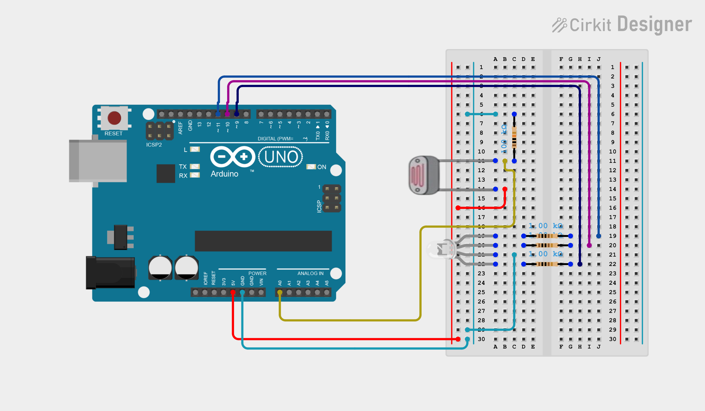

# RGB LED + LDR Physical Reservoir — Experiment Log



## System overview

- **Board:** Arduino Uno R4
- **Input device:** RGB LED, channels on D9 (R), D10 (G), D11 (B), each through a
  series resistor (started at 470 Ω, moved to 1 kΩ for pin-current safety)
- **Sensing device:** CdS photoresistor (LDR), in a voltage divider from 5V to
  GND, midpoint read on A0. Divider resistor: started at 1 kΩ, moved to
  100 kΩ once testing showed the LDR's lit resistance is in the tens of kΩ.
- **Optics:** LED and LDR face each other inside a sealed opaque tube, to
  block ambient light and fix the light path between them.
- **ADC:** 14-bit resolution (`analogReadResolution(14)`, 0–16383 full scale).
- **Core idea:** the LDR's resistance doesn't track light instantly — it lags
  behind by tens to hundreds of milliseconds. That lag is the reservoir's
  **fading memory**: the current reading is a decaying blend of recent LED
  inputs, not just the instantaneous one.

## How the reservoir works

- **Input.** `u[k]` is one random number in 0 to 1 per input step (every 20 slots x 20 ms = 400 ms), drawn from a
  seeded generator on the Arduino and logged. It does not depend on earlier inputs or states; the tasks are defined on it.
- **Encoding.** In slot `i` the blue LED runs at `bias + amp * mask[i] * (2u - 1)`, where the mask is a fixed +1/-1 pattern.
  One number becomes 20 different brightness levels (some slots brighter for larger `u`, some dimmer).
- **Physical node.** The LDR reacts slowly (tens to hundreds of ms) and saturates, which gives it fading memory and
  nonlinearity. Its reading at the end of each slot is one of 20 state values for that input step.
- **Feedback (Phase 4).** During slot `i` the red LED runs at `fb * (scaled reading of slot i one input step earlier)`.
  The board only delays and rescales its own earlier readings; the light does the coupling. Each state therefore
  carries the previous one, and the influence decays by the loop gain (about 0.55) per step.
- **Readout.** Ridge regression (regularised least squares) in Python on the saved CSV: a weighted sum of the 20
  state values plus a constant, with the weights fitted on a training part and scored on held-out data. Different
  targets (an earlier input, a NARMA value, an XOR bit) get different weights on the same states. The readout is not on the
  Arduino and nothing from it feeds back into the LEDs; only the reservoir is physical.

---

## Phase plan

| Phase | Purpose | Status |
|---|---|---|
| 0 | Ground checks — is the electronics sound, is the tube light-tight | ✅ Done |
| 1 | Baseline — does the system respond to light at all, is it monotonic | ✅ Done |
| 2 | Per-channel effect — is the R/G/B response real and repeatable | ✅ Done |
| 3 | Reservoir proper — masked virtual nodes, no feedback; also picks the input channel | ✅ Done (blue chosen) |
| 4 | Feedback loop — delayed self-coupling for deeper memory | ✅ Validated (`bias=16 fb=32`); optional refinements |

Each phase gates the next — a phase isn't trusted until its own checks pass.

---

## Phase 0 — Ground checks

**Purpose:** rule out the electronics or the tube lying to us before trusting
any light-response data.

**Method:** `phase0_ground_checks.ino`, an interactive sketch with four
stages, each requiring a keypress in the Serial Monitor to begin:

1. **A_dark** — LEDs off, tube sealed. 30 s log. Checks the resting noise
   floor and whether it drifts.
2. **B_ambient** — LEDs off, tube sealed and left in place. Room light and a
   phone torch were varied *outside* the tube during the 30 s log, to check
   whether outside light leaks in.
3. **C_short_gnd** — LDR physically removed, the A0/divider node jumpered
   directly to GND. Expect A0 ≈ 0.
4. **C_short_5v** — same node jumpered to 5V instead. Expect A0 ≈ 16383.

**Run 1 (before the tube was sealed properly):** A_dark and the two short
tests passed. B_ambient failed badly — A0 swung from ~8,100 to ~15,750 counts
(nearly full range) just from room light and torch, because the tube wasn't
actually light-tight yet (an open-air setup, not a sealed one).

**Fix:** sealed the LED/LDR pair inside an opaque tube with both ends
plugged around the leads.

**Run 2 (sealed tube):**

| Stage | Mean | Std | Verdict |
|---|---|---|---|
| A_dark | 352 | 11.8 | Pass — stable, no drift between first/second half |
| B_ambient | 534 (mostly 350–600) | 167 | Mostly pass — one spike to ~1,370 counts during a direct phone-torch test against the tube; normal room-light variation stays small next to the signal sizes used later |
| C_short_gnd | 1.3 | 4.4 | Pass |
| C_short_5v | 16,382 | 4.2 | Pass |

**Note:** a fixed-threshold check in the analysis script (`swing < 1000`
counts) flags B_ambient as a hard FAIL at a 1,146-count swing. That threshold
doesn't distinguish a deliberate torch-against-the-tube stress test from
normal conditions — the nuanced read above (mostly pass, keep lighting
steady during real runs) is the one to trust; the hard-coded threshold is
noted as a known simplification in the script.

**Files:** `phase0_ground_checks.ino` (sketch), `analyze_phase0.py`
(analysis — stats + one annotated plot per stage + overview plot).

---

## Phase 1 — Baseline (white light, all channels together)

**Purpose:** confirm the LDR responds to light at all, independent of
colour, and that the response is monotonic with brightness (no reflection,
saturation, or wiring surprises).

**Method:** `phase1_baseline_white.ino`, two stages, all three LED channels
driven together at the same PWM value (equal drive, not equal brightness, so
the light looks bluish rather than white; the LDR just sums the light, so this
does not matter for the check):

1. **onoff:** 5 cycles of all-channels-at-255 (4 s) then all-off (4 s).
2. **sweep:** PWM 0, 64, 128, 192, 255, 192, 128, 64, 0 together, 4 s per
   step, to check the plateau rises monotonically going up and retraces going down.

Same logging style as Phase 2 (20 ms sampling, buffered block writes,
`Serial.flush()` after each step). The run finished cleanly (3,800 rows).

**Results:**

| Check | Result |
|---|---|
| Light-driven | ON–OFF contrast 15,072 counts, 2,806× the OFF-plateau noise (5.4) |
| Repeatable | ON plateau 15,434 (CV 0.015%), OFF plateau 361 (CV 0.12%) across 5 cycles |
| Rise | t63 and t90 both 20 ms (one sample; faster than the sampling can resolve) |
| Fall | t63 120 ms, t90 about 236 ms (std 9 ms across cycles) |
| Monotonic | Yes, going up and going down |
| Hysteresis | Largest up/down difference 10 counts, 0.07% of the full swing |
| Settling | Plateau creep inside a hold at most 3 counts, so 4 s holds are long enough |
| Clipping | Peak reading 15,468, about 949 counts below the 16,383 full scale |

LDR resistance works out to about 4.4 MΩ dark and about 6 kΩ with all channels on
(roughly 700×).

**Finding that shapes later phases: the response is strongly compressive.**
With the 100 kΩ divider, PWM 64 already reaches 91% of the full dark-to-255
swing, 128 reaches 96% and 192 reaches 99%. The steep part of the curve is
between PWM 0 and 64, and this sweep has no points inside it. For the
reservoir the input should be driven inside that low-PWM region, which is why
Phase 3 starts with a finer operating-point sweep (step 3.1).

**Verdict: Pass.**

**Files:** `phase1_baseline_white.ino` (sketch), `phase1/analyze_phase1.py`
(analysis), and four plots in `phase1/` (on/off overlay, rise/fall zoom,
sweep time series, plateau vs PWM with compression).

---

## Phase 2 — Per-channel effect, confirmed real and repeatable

**Purpose:** confirm each colour channel's LDR response is a real,
repeatable effect — not an artefact of one run's particular timing or
ambient state — and that it doesn't depend on which channel ran before it.

**Method:** `phase2_rgb_step_test.ino`. For each channel (R, G, B), the step
sequence PWM = 255→0→64→0→128→0 (4 s per step) was run **3 times** with a
5 s dark settle before each repeat. The whole sequence was then run in
**two channel orders** — order A (R, G, B) and order B (B, G, R) — to check
for order dependence. Sampling at 20 ms (lowered from an earlier 5 ms after
Serial Monitor dropouts on long runs; the sketch also switched to buffered
`Serial.write` block writes with `Serial.flush()` between steps to avoid
losing data mid-run).

**Results:**

- **Repeatability:** coefficient of variation across the 3 repeats was
  under 1.4% in every (order, channel, step) cell, and under 0.2% in most.
  The 6 traces per channel (3 repeats × 2 orders) overlay almost exactly
  when plotted.
- **Order independence:** channel+step plateaus matched between order A and
  order B to within 0.1–1.4%; the largest differences were a few counts on
  the ~380-count dark plateau, not the lit plateaus.
- **Plateau values** (sealed tube, mean across repeats/orders):

  | Channel | PWM 255 | PWM 128 | PWM 64 | Dark |
  |---|---|---|---|---|
  | G | 14,870 | 14,111 | 13,126 | ~378 |
  | R | 13,749 | 12,601 | 11,094 | ~381 |
  | B | 13,359 | 12,172 | 10,672 | ~383 |

- **Time constants** (pooled, 20 ms resolution — coarser than earlier 5 ms
  runs, so treat as indicative):

  | Channel | Rise t63 / t90 | Fall t63 / t90 |
  |---|---|---|
  | R | 20 / 60 ms | 100 / 240 ms |
  | G | 20 / 20 ms | 100 / 220 ms |
  | B | 20 / 40 ms | 60 / 160 ms |

**Verdict: Pass.** Green is the brightest/most responsive channel, red the
slowest to fall (longest memory), blue the fastest overall — consistent
with the working plan of blue or green as the reservoir's input channel and
red as the feedback channel.

**Files:** `phase2_rgb_step_test.ino` (sketch), `analyze_phase2.py`
(analysis — repeatability table, order-independence table, time constants,
per-channel overlay plots, plateau summary bar chart).

---

## Phase 3 — Reservoir proper, no feedback

**Purpose:** show that the node behaves like a reservoir (reproducible,
input-dependent, with usable memory and nonlinearity) before adding feedback,
and pick the input channel (blue or green) with feedback out of the picture.
*Change from the earlier plan: the blue-vs-green decision now happens here, not
in Phase 4, because it is cleaner to compare channels without a feedback loop
in the way.*

**Sketch:** `phase3_4_reservoir.ino` (one sketch for both phases; Phase 3 uses `fb=0`).
Source is in the appendix at the end of this file.

### How the sketch works

- Each input sample `u[k]` (uniform 0 to 1, from a seeded generator) is spread over
  `nodes` virtual-node slots of 20 ms each.
- In slot `i` the input LED is driven at `bias + amp * mask[i] * (2u - 1)`.
  The mask is +1 or -1 per node, generated from a fixed seed (42), separate
  from the input seed, so the same mask is used in every run. That is what lets a
  readout trained on one run be tested on another. (Slot time and mask scheme
  match the earlier single-LED reservoir so results can be compared.)
- The node state is the A0 reading averaged over the last 4 ms of the slot
  (covers at least 2 PWM periods, so the LED's PWM ripple averages out; the
  Phase 1 and Phase 2 data showed ripple at mid-range PWM).
- Logging uses the same pattern that fixed the earlier timeouts: one buffered
  `Serial.write` per row, written right after the LEDs change (never inside the
  measurement window), and a `Serial.flush()` once per input sample.
- Every run is configured by sending one line in the Serial Monitor (115200
  baud, line ending "Newline"). A blank line uses defaults. All parameters are
  echoed into the CSV as a `# PARAMS` comment line, so each file documents itself.

CSV columns: `k,i,u,pwm_in,pwm_fb,adc`. Lines starting with `#` are comments.

### Configuration keys

| Key | Meaning | Default |
|---|---|---|
| `mode` | 0 = reservoir run, 1 = operating-point sweep of one channel | 0 |
| `seed` | input-stream seed (same seed = identical inputs) | 1 |
| `init` | 0 = start dark, 1 = start at full brightness (echo-state check) | 0 |
| `in` | input channel: 0 = R, 1 = G, 2 = B | 2 |
| `fb` | feedback strength on the red LED, PWM units (0 = off) | 0 |
| `inv` | 1 = inverted feedback | 0 |
| `steps` | input samples | 1000 |
| `nodes` | virtual nodes per sample (max 64) | 20 |
| `bias`, `amp` | input drive range, PWM units | provisional per channel |
| `xlo`, `xhi` | reading range scaled to 0..1 for feedback | provisional 8000 / 12500 |
| `tag` | label echoed into the file (15 characters max) | run |

A reservoir run takes about 10 s of pre-conditioning plus `steps x nodes x 20 ms`.
With the defaults that is about 6.8 minutes and 20,000 rows. A sweep takes about 80 s.

### Steps

**3.1 Operating-point sweeps (about 80 s each).** Phase 1 showed the response
is steep below PWM 64 and flat above, so choose the drive range from data
rather than a guess. For each channel, the sketch steps through PWM
0, 2, 4, 8, 12, 16, 24, 32, 48, 64, 96, 128, 192, 255 (3 s on, 2 s off each).

    mode=1 in=2 tag=sweep_blue
    mode=1 in=1 tag=sweep_green
    mode=1 in=0 tag=sweep_red

Pick `bias` and `amp` for blue and green so that `bias - amp` to `bias + amp`
covers the steep, not-yet-saturated part of the curve. The red sweep is for
Phase 4 (it sets the useful range of `fb`). Record the chosen values below.

**3.2 Reservoir runs (about 7 minutes each, 6 runs).** Replace `<B>`/`<A>` with
the bias/amp chosen for that channel.

| Run | Purpose | Config line |
|---|---|---|
| R1 | Blue, training stream | `mode=0 seed=1 init=0 in=2 fb=0 bias=<B> amp=<A> tag=blue_s1_dark` |
| R2 | Blue, echo-state check (different start, same inputs) | `mode=0 seed=1 init=1 in=2 fb=0 bias=<B> amp=<A> tag=blue_s1_bright` |
| R3 | Blue, fresh input stream (test set) | `mode=0 seed=2 init=0 in=2 fb=0 bias=<B> amp=<A> tag=blue_s2_dark` |
| R4 | Green, training stream | `mode=0 seed=1 init=0 in=1 fb=0 bias=<B> amp=<A> tag=green_s1_dark` |
| R5 | Green, test stream | `mode=0 seed=2 init=0 in=1 fb=0 bias=<B> amp=<A> tag=green_s2_dark` |
| R6 | Blue repeat of R1 (run-to-run variation) | `mode=0 seed=1 init=0 in=2 fb=0 bias=<B> amp=<A> tag=blue_s1_dark_rep` |

Check at the end of every file: the row count equals `steps x nodes`, the
footer says `# overruns=0`, and `max_slot_start_late_us` is small (under about
5,000). Any other result means timing slipped and the run should be repeated.

**3.3 Analysis (script written once data exists).** All with the first 50 input
samples discarded as washout:

- **Echo-state check:** R1 vs R2. Normalised difference = mean |x_R1 - x_R2| / std(x_R1) over the
  remaining samples. The states should converge after the washout.
- **Readout:** ridge regression on the node states plus a bias term, with the
  regularisation chosen by cross-validation on the training run. Train on seed 1, test on seed 2.
- **Memory capacity:** `MC_d` is the squared correlation between `u[k-d]` and the
  readout output on the test run. `MC = sum of MC_d for d = 1..10`. `MC_0` is
  how well the current input is recovered.
- **Nonlinear tasks:** NARMA-2 and NARMA-10 (NMSE, input scaled to 0..0.5), and
  delayed XOR of the thresholded inputs (`b[k] XOR b[k-1]`, accuracy).
- **Control:** the same ridge readout fed the last `nodes` raw inputs
  (`u[k], u[k-1], ...`) with no reservoir. The physical node only earns credit
  on the nonlinear tasks if it beats this.
- **Run-to-run variation:** R1 vs R6 gives the spread to compare Phase 4 gains against.
- **Feedback scaling:** the 5th and 95th percentile of the readings in the chosen
  channel's run give `xlo` and `xhi` for Phase 4.

**Provisional pass criteria (fixed before seeing data, to be revised openly if
they prove unrealistic):**

| Check | Criterion |
|---|---|
| Echo-state | normalised difference below 0.1 after washout |
| Input recovery | `MC_0` at least 0.8 |
| Memory | `MC_1` at least 0.3 and total `MC` at least 1.0, decaying smoothly with delay |
| Nonlinearity | beats the no-reservoir control on NARMA-2 and delayed XOR |
| Reproducibility | R1 vs R6 MC differs by less than about 10% |

**Input channel choice:** the channel with the higher total MC and better task
scores under the same protocol, provided it passes the echo-state check.

**Chosen values:** blue `bias=40 amp=35` (PWM 5 to 75; the sweep confirms this spans the steep
part of the curve, plateau 4,127 to 11,447). Green `bias=12 amp=10` (PWM 2 to 22, chosen to
reproduce blue's plateau range). Input channel: blue so far; green still to be compared.
Feedback scaling for Phase 4: `xlo=6000 xhi=12500` (see Phase 4).

**Status: done for blue and green (one open item below).**

*Sweeps (blue, green, red; `phase3/analyze_sweep.py`):*

- All three channels saturate: most of the swing happens at low PWM and the sensitivity falls about
  100-fold from PWM 4 to 128 (blue 690 to 17 counts per PWM unit).
- Light from different LEDs adds up approximately: green is about 3.5x as efficient as blue
  (ratio 3.26 to 3.53 from PWM 8 up), red about 1.0 to 1.4x blue (it drifts upward with level).
- Speed differs a lot by channel (20 ms samples). Fall to 63% takes roughly 20 to 64 ms for blue,
  46 to 114 ms for green and 99 to 119 ms for red; fall to 90% takes about 75 to 210 ms, 194 to 270 ms
  and 285 to 482 ms. Blue is the fastest, which is why its memory is so short; red and green are
  slower and should give more memory as input channels.
- Green's matching drive window is only PWM 2 to 22 (21 distinct levels against 71 for blue), so
  its input resolution is coarser.
- The dark baseline during the sweeps was about 470 to 500 counts, against about 350 to 380 in
  Phases 0 and 2. See the open item below.

*Blue reservoir runs (20 nodes, 1,000 steps; train on seed 1, test on seed 2):*

| Check | Result |
|---|---|
| Timing on the board | `overruns=0`, worst lateness 21 us in every run |
| Memory capacity | `MC_0` 0.998, `MC_1` 0.976, about 0 for delays 2 to 10 (a cliff after one step) |
| XOR of `b[k]` and `b[k-1]` | 0.838 against 0.489 for the linear control |
| XOR needing `u[k-2]` | 0.479, chance |
| NARMA-2 NMSE | 0.188 against 0.156 for the control (no advantage) |
| NARMA-10 NMSE | 0.730 against 0.159 for the control |
| Echo-state | passes: normalised difference 0.076 for bright vs dark start after removing a global offset, the same as 0.071 between two identical dark runs; the start state is forgotten within 1 to 2 steps |
| Reproducibility | total `MC` within 0.3% across three identical runs; NARMA-2 0.175 to 0.188, NARMA-10 0.721 to 0.744, XOR 0.838 to 0.883 depending on which identical run trains the readout |

*Run-to-run offset.* Identical runs differ by a global additive offset, the same for every node
(for example +293 counts between two identical dark runs, -68 between two others), and the offset
shrinks over a run (375 to 241 counts across one comparison). It does not hurt the squared-correlation
memory measure but shifts raw readings, so Phase 4 comparisons need to allow for it. A raw echo-state
difference of 0.245 (above the 0.1 criterion) is entirely this offset; the analysis script now removes it.

*Provisional criteria:* `MC_0`, `MC_1`, XOR (`tau=0`), echo-state and reproducibility pass. Total `MC`
0.991 against 1.0 narrowly misses an arbitrary threshold. Smooth decay of memory, NARMA-2 against the
control, and XOR needing `u[k-2]` fail, all for the same reason: the node's memory ends after one input step.

*Green reservoir runs (`bias=12 amp=10`, rerun after the first attempt used `bias=0 amp=0`; train seed 1, test seed 2):*
`MC_0` 0.997, `MC_1` 0.978, about 0 beyond (the same one-step cliff as blue); XOR of `b[k]` and `b[k-1]` 0.867
(control 0.489); XOR needing `u[k-2]` 0.483; NARMA-2 0.167 (control 0.156); NARMA-10 0.730 (control 0.159).
The node is slower than blue (drive 0, 1, 2, 3 slots ago has weight 132, 43, 22, 12 counts per PWM unit
against 51, 9, 4, 2 for blue), but memory still ends after one input step. The differences from blue are
within or close to blue's run-to-run spread (XOR 0.838 to 0.883, NARMA-2 0.175 to 0.188), and green's
input is coarser (21 drive levels against 71). No evidence green is better, so blue stays the input
channel. Echo-state and repeat runs were not done for green.

*Open item:* a quick Phase 0 recheck (`A_dark` and `B_ambient`), because the dark baseline rose by about
120 counts since Phase 0, which could mean the tube seal loosened.

---

## Phase 4 — Feedback loop

**Purpose:** add delayed feedback to get longer memory while keeping fading
memory, and find the feedback strength that gives the most benefit before the
loop saturates or latches.

**Sketch:** the same `phase3_4_reservoir.ino`, now with `fb > 0`.

**Feedback scheme:** the red LED is driven at `fb * x_prev[i]`, where `x_prev[i]`
is the scaled reading (0 to 1) of the same virtual node one input sample earlier.
The delay is therefore `nodes x 20 ms`, and the LDR's own lag couples neighbouring
nodes. Red is used because its response falls slowest (longest tail) and it
keeps the feedback strength separate from the input amplitude (they are
different LED channels with their own PWM ranges). `inv=1` flips the sign.

**Prerequisites:** Phase 3 passed; input channel, `bias`, `amp`, `xlo`, `xhi` chosen; the
red sweep (3.1) done.

### Steps

**4.1 Gain sweep (about 7 minutes each).** Same input stream (seed 1) and dark start for every
gain. Keep `xlo=6000 xhi=12500` fixed across the sweep. The fb=0 range (7,600 to 11,100) is too narrow:
feedback adds light and pushes the readings upward, and the static model in
`phase3/analyze_sweep.py` shows 35% of readings clipped at the top already at `fb=16` with that range.
With 6,000 to 12,500 there is no clipping up to `fb=32`, about 4% at 48 and about 40% at 64, so 64
is a deliberate saturation probe. Beyond about 64 the model saturates completely.

| Run | `fb` | Static-model loop gain (upper bound) |
|---|---|---|
| G0 | 0 (reuse `blue_s1_dark.csv`, seed-2 baseline `blue_s2_dark.csv`) | 0 |
| G1 | 16 | 0.19 |
| G2 | 32 | 0.23 |
| G3 | 48 | 0.23 |
| G4 | 64 | 0.24 (clipping) |

An `fb=8` run (loop gain 0.10) is optional. The loop gain stops growing at about 0.24 because the
curve saturates as the added light raises the readings; the real 20 ms loop gain is lower still,
since red has only reached 20 to 45% of its plateau after the first 20 ms at these levels. Even a small
loop gain can extend memory here because the readout is so precise (noise of about 10 counts against
hundreds of counts of signal).

    mode=0 seed=1 init=0 in=2 fb=<gain> bias=40 amp=35 xlo=6000 xhi=12500 tag=fb<gain>_s1_dark

For each gain run the Phase 3 analysis and compare with G0. Noise yardstick from the three identical
`fb=0` runs: total `MC` within 0.01, NARMA-2 NMSE within 0.015, NARMA-10 NMSE within 0.025, XOR accuracy
within 0.05. A benefit has to exceed these. The selected gain is where `MC_2`, XOR needing `u[k-2]` and
NARMA-10 improve before they fall off.

**4.2 Echo-state check with feedback.** Repeat the selected gain and the highest gain with
`init=1`. Positive feedback through a saturating node can latch (stay in a state
instead of fading), so this is the check that the memory still fades.

    mode=0 seed=1 init=1 in=<ch> fb=<gain> ... tag=fb<gain>_s1_bright

**4.3 Cross-run validation.** Run the selected gain with `seed=2`, train the readout on the
seed-1 run, test on the seed-2 run, and compare with the same train/test split
at `fb=0` (R1 and R3, or R4 and R5 for green). Optionally also run the
selected gain with `inv=1`.

**4.4 Optional comparison run.** The best configuration with `nodes=50 steps=1500`
(about 25 minutes) for comparison with the earlier single-LED build.

**Provisional pass criteria:**

| Check | Criterion |
|---|---|
| Benefit | total MC (and at least one of NARMA / XOR) improves over `fb=0` by more than the R1 vs R6 spread, on the held-out seed-2 stream |
| Fading memory | echo-state normalised difference still below 0.1 at the selected gain |
| No saturation | readings not pinned near the top of the range (check the 95th percentile against the ADC full scale) |

**Failure modes:** readings pinned high, so lower `fb` or raise `xhi`; echo-state
check fails (latching), so lower `fb` or try `inv=1`; no change from `fb=0`, so raise `fb` or
check the red sweep range.

**Status: validated for `bias=16 fb=32` (see below); optional refinements remain.**

*Results of the seven runs* (blue input, 20 nodes, 1,000 steps, seed 1, blocked split inside each run;
the linear control scores NARMA-2 0.178, NARMA-10 0.148, XOR needing `u[k-2]` 0.461 for every row):

| Run | median reading (5th to 95th) | input effect (lag-0, counts/PWM) | `MC_2` | `MC_3` | total `MC` | NARMA-2 | NARMA-10 | XOR `tau=0` | XOR `tau=1` |
|---|---|---|---|---|---|---|---|---|---|
| bias 40, `fb=0` | 10,073 (7,562 to 11,086) | 50.9 | 0.001 | 0.002 | 0.987 | 0.189 | 0.704 | 0.832 | 0.463 |
| bias 40, `fb=16` | 10,917 (9,334 to 11,659) | 34.1 | 0.542 | 0.023 | 1.511 | 0.073 | 0.673 | 0.826 | 0.463 |
| bias 40, `fb=32` | 11,890 (10,950 to 12,389) | 21.1 | 0.586 | 0.045 | 1.582 | 0.134 | 0.668 | 0.739 | 0.474 |
| bias 40, `fb=48` | 12,271 (11,572 to 12,685), 25% at or above `xhi` | 16.6 | 0.513 | 0.022 | 1.493 | 0.098 | 0.661 | 0.726 | 0.605 |
| bias 40, `fb=32 inv=1` | 10,753 (9,022 to 11,538) | 37.5 | 0.713 | 0.297 | 2.048 | 0.202 | 0.715 | 0.816 | 0.463 |
| bias 16, `fb=0` | 7,079 (4,412 to 8,323) | 146.7 | 0.001 | 0.003 | 0.997 | 0.174 | 0.700 | 0.784 | 0.458 |
| bias 16, `fb=32` | 10,458 (9,581 to 10,984) | 51.6 | 0.693 | 0.210 | 1.874 | 0.038 | 0.663 | 0.792 | 0.563 |

What this shows:

- Positive feedback extends memory from one input step to about three (`MC_2` 0.5 to 0.7) at every gain tested,
  and NARMA-2 drops well below the control. At bias 40 the cost grows with the gain: the added red light pushes
  the readings into the flat part of the curve and the input's effect falls from 51 to 17 counts per PWM unit.
- Lowering the blue drive to bias 16 compensates: with `fb=32` the input effect is back to 52 (the static model
  predicted this), readings sit mid-range with no clipping, and this run has the best NARMA-2 (0.038), the most
  retained nonlinearity and `MC_3` 0.21. It is the best candidate.
- Negative feedback gives the most memory (total `MC` 2.05, `MC_3` 0.30) but no task benefit (NARMA-2 0.202).
- NARMA-10 stays at 0.66 to 0.72 against 0.148 for the control in every configuration: three steps of memory is
  not enough for a task that needs about ten.
- Echo-state with feedback (bias 40, `fb=32`, bright start against dark start): passes, 0.063 after removing the
  global offset. The difference shrinks by about 0.55 per input step (2,007, 1,039, 573, 327, 116, 24 counts at steps
  0 to 10), so the effective loop gain is about 0.55 and the start state is forgotten in about 6 to 10 steps
  (1 to 2 steps without feedback). This is fading memory.

*Held-out stream and the run-to-run offset.* Training on seed 1 and testing on seed 2 (bias 40, `fb=32`) gave
`MC` unchanged (total 1.54) but NARMA-2 0.527 and XOR 0.596, far worse than the 0.134 and 0.739 from the split
inside one run. Cause: runs differ by a global additive offset (about -144 counts between these two runs), and
with feedback the node's signal is small (standard deviation 450 counts against 1,106 without feedback), so the offset
is a third of the signal. With each run's per-node mean removed (`--center`), the same test gives NARMA-2 0.082,
XOR 0.818, XOR `tau=1` 0.588 (against 0.176, 0.866 and 0.484 for `fb=0`). Removing the mean uses the test run's own
data, so it is a diagnostic, not a usable method; a real system would need a reference reading per run
(for example a logged dark baseline, which the sketch does not do yet).

*Validation of `bias=16 fb=32`* (six more runs, all 20,000 rows, `overruns=0`):

| Held-out stream (train seed 1, test seed 2), per-run mean removed | `fb=0` | `fb=32` | `fb=32` repeat |
|---|---|---|---|
| total `MC` | 0.994 | 1.748 | 1.768 |
| `MC_2` / `MC_3` | 0.002 / 0.000 | 0.652 / 0.128 | |
| NARMA-2 NMSE (control 0.156) | 0.166 | 0.077 | 0.067 |
| NARMA-10 NMSE (control 0.159) | 0.741 | 0.707 | 0.705 |
| XOR `b[k]`,`b[k-1]` accuracy | 0.811 | 0.748 | 0.758 |
| XOR needing `u[k-2]` | 0.483 | 0.598 | 0.618 |

- Reproducibility: total `MC` differs by 1.1% between the main run and its repeat; with the mean removed every metric
  agrees within 0.02.
- Echo-state: passes, 0.085 against the 0.1 limit (0.063 at bias 40). Forgetting the start state takes about 15 to 20
  input steps, against 8 to 10 at bias 40 and 1 to 2 without feedback. The loop is stronger here and closer to the limit.
- Without removing the mean the held-out scores are unreliable: NARMA-2 is 5.25 when the main run trains the readout but
  0.109 when its repeat does (offset -292 counts between the runs); at `fb=0` the raw figures are NARMA-2 0.359 and XOR 0.484
  against 0.166 and 0.811 with the mean removed. `MC` is unaffected.
- Gain at bias 16 (split inside the run, seed 1): `fb=16` total `MC` 1.856, `fb=32` 1.874 (repeat 1.805), `fb=48` 1.761.
  `MC_2` is about 0.67 to 0.69 at all three, `MC_3` falls from 0.21 to 0.14 at `fb=48`, and the input effect falls from 88
  to 52 to 31 counts per PWM unit. Two identical `fb=32` runs differ by 0.07 in total `MC` and up to 0.1 in XOR, so `fb=16`
  and `fb=32` cannot be separated; more gain does not deepen the memory.
- Provisional Phase 4 criteria: benefit over `fb=0` beyond the run-to-run spread (met, with the mean removed), fading memory
  (met), no saturation (met: no readings at `xhi`, 95th percentile 10,984).

*Where it stands.* Feedback gives a reservoir with about three input steps of memory that fades, is reproducible and
beats the linear control on NARMA-2 and on XOR needing `u[k-2]`. Not solved: NARMA-10 (0.71 against 0.16, it needs about ten steps),
a trade-off in the plain XOR (0.81 to 0.75), and the run-to-run offset. The offset is the same for every node,
shrinks over a run, and may be the photoresistor's slow memory of earlier light (to be tested).

*Possible next runs* (all `in=2 bias=16 amp=14`, seed 1, dark start):

| Purpose | Config line |
|---|---|
| Feedback scaled to the actual reading span, same light, finer feedback steps | `mode=0 seed=1 init=0 in=2 fb=16 bias=16 amp=14 xlo=8500 xhi=11500 tag=b16f16_narrow` |
| The same, stronger (needs an echo-state check; may latch) | `mode=0 seed=1 init=0 in=2 fb=32 bias=16 amp=14 xlo=8500 xhi=11500 tag=b16f32_narrow` |
| Larger comparison, feedback (about 25 min) | `mode=0 seed=1 init=0 in=2 fb=32 bias=16 amp=14 xlo=6000 xhi=12500 nodes=50 steps=1500 tag=b16f32_n50` |
| Larger comparison, no feedback (about 25 min) | `mode=0 seed=1 init=0 in=2 fb=0 bias=16 amp=14 xlo=6000 xhi=12500 nodes=50 steps=1500 tag=b16f0_n50` |

The feedback LED only spans 13 to 26 PWM levels at `fb=32` with the wide scaling, so the narrow scaling tests whether
coarse feedback steps limit memory depth. A longer dark settle and a logged baseline per run (a small sketch change) would test the offset hypothesis.

---

## Appendix — `phase3_4_reservoir.ino`


```cpp
// Phases 3 and 4: single-node, time-multiplexed physical reservoir
// RGB LED (input, optional feedback) -> photoresistor (the physical node)
// Board: Arduino Uno R4
// Wiring: LED R/G/B -> D9/D10/D11 (via 1 kOhm resistors), LDR divider midpoint -> A0
//         (LDR from 5V to A0, 100 kOhm from A0 to GND), LED + LDR inside the sealed tube.
//
// HOW IT IS USED
//   Phase 3 = this sketch with fb=0 (no feedback).
//   Phase 4 = the same sketch with fb>0 (red LED driven by the node's own earlier state).
//   Every run is configured from the Serial Monitor, so there is no editing or
//   re-uploading between runs. After upload, set the Serial Monitor to
//   115200 baud and line ending "Newline", then send ONE line, for example:
//
//       mode=0 seed=1 init=0 in=2 fb=0 tag=blue_s1_dark
//
//   A blank line (just Enter) uses the defaults below. Keys:
//       mode   0 = reservoir run (default), 1 = operating-point sweep of one channel
//       seed   random seed of the input stream (default 1). Same seed = same inputs.
//       init   0 = start from dark (default), 1 = start from full brightness (for the
//              echo-state check: two different starting states, same inputs)
//       in     input channel: 0=R(D9), 1=G(D10), 2=B(D11) (default 2)
//       fb     feedback strength in PWM units on the red LED (default 0 = off)
//       inv    0 = positive feedback (default), 1 = inverted feedback
//       steps  number of input samples (default 1000)
//       nodes  virtual nodes per input sample (default 20, max 64)
//       bias, amp   input drive = bias +/- amp (PWM units). PROVISIONAL defaults below;
//              replace them with values chosen from the mode=1 sweep.
//       xlo, xhi    reading range used to scale the node state to 0..1 for feedback
//              (PROVISIONAL defaults; Phase 3 analysis prints the values to use)
//       tag    free-text label (max 15 chars) echoed into the CSV header
//
// SCHEME (per input sample u[k] in 0..1, spread over N virtual-node slots of THETA_MS):
//   input drive in slot i : pwm_in = bias + amp * mask[i] * (2*u[k] - 1)     mask[i] = +1 or -1
//   feedback drive        : pwm_fb = fb * x_prev[i]       (x_prev[i] = scaled reading of the same
//                           virtual node one input sample ago, 0..1; delay = nodes * THETA_MS)
//   state of node i       : A0 reading averaged over the last WINDOW_US of the slot
//
// OUTPUT (CSV over Serial):  k,i,u,pwm_in,pwm_fb,adc
//   mode 0: k = input sample, i = virtual node, u = input in 0..1
//   mode 1: k = level index, i = sample within the level (150 ON, then 100 OFF), u = 0
// Lines starting with '#' are comments (parameters, warnings, summary, DONE).
//
// The mask is generated from MASK_SEED, separate from the input seed, so the same
// mask is used in every run and a readout trained on one run can be tested on another.

#include <Arduino.h>
#include <stdio.h>
#include <stdlib.h>
#include <string.h>

#define MAX_NODES 64

const uint8_t  LED_PIN[3] = {9, 10, 11};   // 0=R, 1=G, 2=B
const uint8_t  LDR_PIN    = A0;
const uint8_t  FB_CH      = 0;             // feedback goes to red
const uint16_t THETA_MS   = 20;            // virtual-node slot length
const uint32_t SLOT_US    = (uint32_t)THETA_MS * 1000UL;
const uint32_t WINDOW_US  = 4000;          // averaging window at the end of each slot (>= 2 PWM periods)
const uint32_t MASK_SEED  = 42;
const uint32_t INIT_MS    = 10000;         // pre-condition time before a run

// PROVISIONAL per-channel drive ranges. Replace using the mode=1 sweep results.
const int DEF_BIAS[3] = {40, 15, 40};
const int DEF_AMP[3]  = {35, 12, 35};

struct Config {
  int  mode    = 0;
  long seed    = 1;
  int  init    = 0;
  int  inCh    = 2;
  int  fbGain  = 0;
  int  fbInv   = 0;
  int  steps   = 1000;
  int  nodes   = 20;
  int  bias    = -1;     // -1 = use channel default
  int  amp     = -1;
  int  xlo     = 8000;   // PROVISIONAL
  int  xhi     = 12500;  // PROVISIONAL
  char tag[16] = "run";
} cfg;

uint32_t overruns  = 0;
int32_t  maxLateUs = 0;

struct Row {
  uint16_t k, i;
  int u1000, pIn, pFb, adc;
  bool valid;
} pending = {0, 0, 0, 0, 0, 0, false};

// ---------------------------------------------------------------- helpers
void allLEDs(int v) {
  for (uint8_t c = 0; c < 3; c++) analogWrite(LED_PIN[c], v);
}

void driveLEDs(int inVal, int fbVal) {
  for (uint8_t c = 0; c < 3; c++) {
    int v = 0;
    if (c == cfg.inCh) v += inVal;
    if (c == FB_CH)    v += fbVal;
    analogWrite(LED_PIN[c], constrain(v, 0, 255));
  }
}

void writePending() {
  if (!pending.valid) return;
  char buf[64];
  int len = snprintf(buf, sizeof(buf), "%d,%d,%d.%03d,%d,%d,%d\r\n",
                     (int)pending.k, (int)pending.i,
                     pending.u1000 / 1000, pending.u1000 % 1000,
                     pending.pIn, pending.pFb, pending.adc);
  if (len > 0) Serial.write((const uint8_t*)buf, len);
  pending.valid = false;
}

// Average the ADC over the last WINDOW_US before endUs, so the LED's PWM ripple averages out.
int readWindow(uint32_t endUs) {
  uint32_t startUs = endUs - WINDOW_US;
  if ((int32_t)(micros() - startUs) > 0) overruns++;      // already inside the window
  while ((int32_t)(micros() - startUs) < 0) { }
  uint32_t sum = 0;
  uint32_t cnt = 0;
  while ((int32_t)(micros() - endUs) < 0) {
    sum += analogRead(LDR_PIN);
    cnt++;
  }
  if (cnt == 0) return analogRead(LDR_PIN);
  return (int)((sum + cnt / 2) / cnt);
}

// One slot: set the LEDs at the slot start, log the previous row, then measure at the slot end.
int runSlot(uint32_t slotEnd, int inVal, int fbVal, bool doFlush) {
  int32_t late = (int32_t)(micros() - (slotEnd - SLOT_US));
  if (late > maxLateUs) maxLateUs = late;
  driveLEDs(inVal, fbVal);
  writePending();
  if (doFlush) Serial.flush();
  return readWindow(slotEnd);
}

bool readLine(char* buf, size_t n) {
  size_t len = 0;
  while (true) {
    while (!Serial.available()) { }
    char c = (char)Serial.read();
    if (c == '\r') continue;
    if (c == '\n') { buf[len] = 0; return true; }
    if (len < n - 1) buf[len++] = c;
  }
}

void parseConfig(char* line) {
  char* tok = strtok(line, " ,");
  while (tok) {
    char* eq = strchr(tok, '=');
    if (eq) {
      *eq = 0;
      const char* key = tok;
      const char* val = eq + 1;
      if      (!strcmp(key, "mode"))  cfg.mode   = atoi(val);
      else if (!strcmp(key, "seed"))  cfg.seed   = atol(val);
      else if (!strcmp(key, "init"))  cfg.init   = atoi(val);
      else if (!strcmp(key, "in"))    cfg.inCh   = atoi(val);
      else if (!strcmp(key, "fb"))    cfg.fbGain = atoi(val);
      else if (!strcmp(key, "inv"))   cfg.fbInv  = atoi(val);
      else if (!strcmp(key, "steps")) cfg.steps  = atoi(val);
      else if (!strcmp(key, "nodes")) cfg.nodes  = atoi(val);
      else if (!strcmp(key, "bias"))  cfg.bias   = atoi(val);
      else if (!strcmp(key, "amp"))   cfg.amp    = atoi(val);
      else if (!strcmp(key, "xlo"))   cfg.xlo    = atoi(val);
      else if (!strcmp(key, "xhi"))   cfg.xhi    = atoi(val);
      else if (!strcmp(key, "tag"))   { strncpy(cfg.tag, val, sizeof(cfg.tag) - 1); cfg.tag[sizeof(cfg.tag) - 1] = 0; }
      else { Serial.print("# WARNING unknown key: "); Serial.println(key); }
    }
    tok = strtok(NULL, " ,");
  }
}

void finalizeConfig() {
  bool provisional = (cfg.bias < 0 || cfg.amp < 0);
  if (cfg.inCh < 0 || cfg.inCh > 2) cfg.inCh = 2;
  if (cfg.bias < 0) cfg.bias = DEF_BIAS[cfg.inCh];
  if (cfg.amp  < 0) cfg.amp  = DEF_AMP[cfg.inCh];
  if (cfg.nodes < 2) cfg.nodes = 2;
  if (cfg.nodes > MAX_NODES) cfg.nodes = MAX_NODES;
  if (cfg.steps < 1) cfg.steps = 1;
  if (cfg.steps > 65000) cfg.steps = 65000;
  if (cfg.xhi <= cfg.xlo) { cfg.xlo = 8000; cfg.xhi = 12500; Serial.println("# WARNING xhi<=xlo, reset to defaults"); }
  if (cfg.fbGain < 0) cfg.fbGain = 0;
  if (cfg.mode == 0 && provisional) Serial.println("# NOTE bias/amp are PROVISIONAL defaults");
  if (cfg.mode == 0 && cfg.fbGain > 0 && cfg.inCh == FB_CH) Serial.println("# WARNING input channel equals feedback channel (red)");
}

void printParams() {
  char b[220];
  snprintf(b, sizeof(b),
           "# PARAMS tag=%s mode=%d seed=%ld init=%d in=%d fb=%d inv=%d steps=%d nodes=%d theta_ms=%d "
           "bias=%d amp=%d xlo=%d xhi=%d mask_seed=%lu window_us=%lu",
           cfg.tag, cfg.mode, cfg.seed, cfg.init, cfg.inCh, cfg.fbGain, cfg.fbInv, cfg.steps, cfg.nodes,
           (int)THETA_MS, cfg.bias, cfg.amp, cfg.xlo, cfg.xhi,
           (unsigned long)MASK_SEED, (unsigned long)WINDOW_US);
  Serial.println(b);
}

// ---------------------------------------------------------------- run modes
void runReservoir() {
  const int n = cfg.nodes;
  static int8_t mask[MAX_NODES];
  static float  xprev[MAX_NODES];

  randomSeed(MASK_SEED);
  for (int i = 0; i < n; i++) {
    mask[i]  = random(0, 2) ? 1 : -1;
    xprev[i] = 0.0f;
  }
  randomSeed((unsigned long)cfg.seed);

  allLEDs(cfg.init ? 255 : 0);       // choose the starting state of the physical node
  delay(INIT_MS);
  pending.valid = false;

  uint32_t slotEnd = micros() + SLOT_US;
  for (int k = 0; k < cfg.steps; k++) {
    int   u1000 = (int)random(0, 1001);
    float u0    = 2.0f * (u1000 / 1000.0f) - 1.0f;
    for (int i = 0; i < n; i++) {
      float pIn   = cfg.bias + cfg.amp * mask[i] * u0;
      int   inVal = constrain((int)(pIn + 0.5f), 0, 255);
      float x     = xprev[i];
      float pFb   = cfg.fbGain * (cfg.fbInv ? (1.0f - x) : x);
      int   fbVal = constrain((int)(pFb + 0.5f), 0, 255);

      int adc = runSlot(slotEnd, inVal, fbVal, i == 0);

      float xn = (float)(adc - cfg.xlo) / (float)(cfg.xhi - cfg.xlo);
      xprev[i] = constrain(xn, 0.0f, 1.0f);
      pending.k = k; pending.i = i; pending.u1000 = u1000;
      pending.pIn = inVal; pending.pFb = fbVal; pending.adc = adc; pending.valid = true;
      slotEnd += SLOT_US;
    }
  }
  writePending();
  allLEDs(0);
}

void runSweep() {
  const uint8_t  levels[] = {0, 2, 4, 8, 12, 16, 24, 32, 48, 64, 96, 128, 192, 255};
  const int      nLevels  = sizeof(levels) / sizeof(levels[0]);
  const uint16_t ON_SAMPLES  = 150;     // 3 s on
  const uint16_t OFF_SAMPLES = 100;     // 2 s off

  allLEDs(0);
  delay(5000);
  pending.valid = false;

  uint32_t slotEnd = micros() + SLOT_US;
  for (int li = 0; li < nLevels; li++) {
    for (uint16_t s = 0; s < ON_SAMPLES + OFF_SAMPLES; s++) {
      int val = (s < ON_SAMPLES) ? levels[li] : 0;
      int adc = runSlot(slotEnd, val, 0, s == 0);
      pending.k = li; pending.i = s; pending.u1000 = 0;
      pending.pIn = val; pending.pFb = 0; pending.adc = adc; pending.valid = true;
      slotEnd += SLOT_US;
    }
  }
  writePending();
  allLEDs(0);
}

// ---------------------------------------------------------------- Arduino entry points
void setup() {
  Serial.begin(115200);
  while (!Serial) { }
  analogReadResolution(14);          // Uno R4: 14-bit ADC (0-16383)
  for (uint8_t c = 0; c < 3; c++) pinMode(LED_PIN[c], OUTPUT);
  allLEDs(0);

  Serial.println("# ldr_reservoir ready. Send ONE line then Enter (blank line = defaults).");
  Serial.println("# example: mode=0 seed=1 init=0 in=2 fb=0 tag=blue_s1_dark");
  Serial.println("# example: mode=1 in=2 tag=sweep_blue");
  char line[120];
  readLine(line, sizeof(line));
  parseConfig(line);
  finalizeConfig();
  printParams();
  Serial.println("k,i,u,pwm_in,pwm_fb,adc");
  Serial.flush();
  delay(1000);

  if (cfg.mode == 1) runSweep();
  else               runReservoir();

  char b[96];
  snprintf(b, sizeof(b), "# overruns=%lu max_slot_start_late_us=%ld",
           (unsigned long)overruns, (long)maxLateUs);
  Serial.println(b);
  Serial.println("# DONE");
  Serial.flush();
}

void loop() { }
```